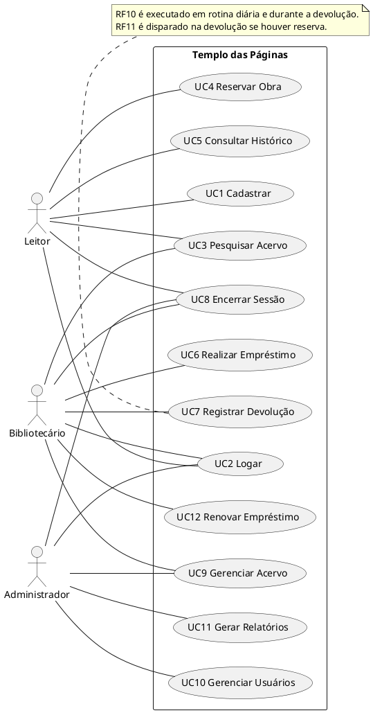

# Casos de Uso — Templo das Páginas

## Atores e associações

| Ator | Casos de uso |
|---|---|
| Leitor | UC1 Cadastrar; UC2 Logar; UC3 Pesquisar Acervo; UC4 Reservar Obra; UC5 Consultar Histórico; UC8 Encerrar Sessão. |
| Bibliotecário | UC2 Logar; UC3 Pesquisar Acervo; UC6 Realizar Empréstimo; UC7 Registrar Devolução; UC8 Encerrar Sessão; UC9 Gerenciar Acervo; UC12 Renovar Empréstimo. |
| Administrador | UC2 Logar; UC8 Encerrar Sessão; UC9 Gerenciar Acervo; UC10 Gerenciar Usuários; UC11 Gerar Relatórios. |

RF10 (controlar atrasos) e RF11 (notificar leitor) são executados automaticamente: RF10 em rotina diária e durante UC7; RF11 após devolução de obra reservada em UC7.

## Especificações

### UC1 — Cadastrar
- **Ator principal:** Leitor. **Secundários:** N/A.
- **Resumo:** criar cadastro para acesso ao sistema.
- **Pré-condições:** acesso à internet e dados solicitados disponíveis.
- **Pós-condições:** cadastro criado se válido; usuário redirecionado ao login.
- **Fluxo principal:** 1. Selecionar “Realizar cadastro”. 2. Informar nome, documento, e-mail e senha. 3. Sistema valida os dados. 4. Sistema confirma o cadastro. 5. Sistema redireciona ao login.
- **Restrições:** dados inválidos ou e-mail já cadastrado impedem o cadastro (RN06).

### UC2 — Logar
- **Atores:** Leitor, Bibliotecário ou Administrador.
- **Resumo:** autenticar o usuário para acesso à aplicação.
- **Pré-condições:** acesso à internet, cadastro existente e credenciais disponíveis.
- **Pós-condições:** usuário direcionado à tela inicial de seu perfil.
- **Fluxo principal:** informar e-mail e senha; acionar login; sistema valida credenciais e perfil; sistema libera acesso.
- **Exceção:** credenciais inválidas não liberam acesso e geram mensagem de erro.

### UC3 — Pesquisar Acervo
- **Atores:** Leitor ou Bibliotecário.
- **Pré-condição:** usuário autenticado.
- **Pós-condição:** obras encontradas são exibidas com quantidade disponível.
- **Fluxo principal:** selecionar “Pesquisar acervo”; informar título, autor, assunto ou ISBN; solicitar busca; sistema consulta e apresenta resultados em até 3 segundos (RNF02).
- **Exceções:** termo vazio solicita preenchimento; ausência de resultados gera mensagem clara.

### UC4 — Reservar Obra
- **Ator:** Leitor.
- **Pré-condições:** leitor autenticado e ativo; nenhum exemplar disponível.
- **Pós-condição:** reserva registrada na fila da obra.
- **Fluxo principal:** localizar obra (UC3); selecionar “Reservar”; confirmar; sistema verifica indisponibilidade, registra na fila e confirma.
- **Regras/exceções:** se houver exemplar disponível, orientar a realizar empréstimo; disponibilizada a obra, retenção por 48 horas (RN08); leitor pode cancelar.

### UC5 — Consultar Histórico
- **Ator:** Leitor.
- **Pré-condição:** leitor autenticado.
- **Pós-condição:** empréstimos, reservas e pendências do leitor são exibidos.
- **Fluxo principal:** selecionar “Meu histórico”; sistema consulta os dados do usuário autenticado e exibe empréstimos ativos e encerrados, reservas e pendências.
- **Restrições:** leitor só visualiza os próprios dados; sem registros, exibir mensagem informativa.

### UC6 — Realizar Empréstimo
- **Ator principal:** Bibliotecário. **Ator secundário:** Leitor.
- **Pré-condições:** bibliotecário autenticado; leitor ativo e sem pendências; exemplar disponível.
- **Pós-condições:** empréstimo registrado, exemplar indisponível e data de devolução informada.
- **Fluxo principal:** identificar leitor; informar exemplar; confirmar; sistema verifica RN01, RN05 e RN07; registra o empréstimo; calcula data conforme RN02; exibe comprovante.
- **Exceções:** limite de empréstimos atingido, leitor impedido ou obra de consulta local recusam operação com mensagem explicativa.

### UC7 — Registrar Devolução
- **Ator:** Bibliotecário.
- **Pré-condições:** bibliotecário autenticado e exemplar com empréstimo ativo.
- **Pós-condições:** exemplar disponível; eventual penalidade aplicada; próximo leitor notificado se houver reserva.
- **Fluxo principal:** informar exemplar; confirmar; sistema localiza empréstimo, verifica atraso e aplica RN04, atualiza disponibilidade e notifica próximo da fila se houver reserva.
- **Exceção:** sem empréstimo ativo, devolução não é registrada.

### UC8 — Encerrar Sessão
- **Atores:** Leitor, Bibliotecário ou Administrador.
- **Pré-condição:** usuário autenticado.
- **Fluxo principal:** acionar logout; sistema encerra sessão e redireciona à tela de login.
- **Pós-condição:** sessão encerrada.

### UC9 — Gerenciar Acervo
- **Atores:** Bibliotecário ou Administrador.
- **Pré-condição:** usuário autenticado com perfil autorizado.
- **Pós-condição:** acervo atualizado.
- **Fluxo principal:** selecionar “Gerenciar acervo”; escolher cadastrar, editar ou remover; informar/alterar título, autor, ISBN, categoria, tipo e quantidade; confirmar; sistema valida, verifica permissão, grava e confirma.
- **Restrições:** aplicar RN09 e RN10; remoção exige confirmação.

### UC10 — Gerenciar Usuários
- **Ator:** Administrador.
- **Pré-condição:** administrador autenticado.
- **Pós-condição:** conta criada, alterada ou desativada.
- **Fluxo principal:** selecionar “Gerenciar usuários”; escolher criar, editar ou desativar; informar/alterar dados e perfil; confirmar; sistema valida e-mail único, grava e confirma.
- **Restrições:** aplicar RN06; conta desativada não pode acessar o sistema.

### UC11 — Gerar Relatórios
- **Ator:** Administrador.
- **Pré-condição:** administrador autenticado.
- **Pós-condição:** relatório solicitado exibido.
- **Fluxo principal:** selecionar “Relatórios”; escolher obras mais emprestadas, atrasos ou movimentação mensal; informar período; solicitar geração; sistema consolida dados e exibe resultado.
- **Exceções/restrições:** acesso somente a administradores; sem dados no período, exibir mensagem informativa.

### UC12 — Renovar Empréstimo
- **Ator principal:** Bibliotecário. **Ator secundário:** Leitor.
- **Pré-condições:** bibliotecário autenticado e leitor com empréstimo ativo.
- **Pós-condição:** empréstimo renovado e nova data de devolução informada.
- **Fluxo principal:** identificar leitor; selecionar empréstimo; confirmar; sistema verifica RN03; registra renovação, calcula prazo conforme RN02 e exibe comprovante.
- **Exceções:** recusar após duas renovações, se houver reserva pendente ou atraso, informando o motivo.

## Fonte PlantUML do diagrama de casos de uso



## Template para novo caso de uso

```markdown
### UCXX — [Nome]
- **Ator principal:** [perfil]. **Secundários:** [perfil ou N/A].
- **Resumo:** [objetivo].
- **Pré-condições:** [condições antes do fluxo].
- **Pós-condições:** [resultado].
- **Fluxo principal:** 1. [Ação do ator]. 2. [Resposta do sistema].
- **Fluxos alternativos/exceções:** [condição e resposta].
- **Regras/requisitos relacionados:** [RF/RNF/RN].
```
