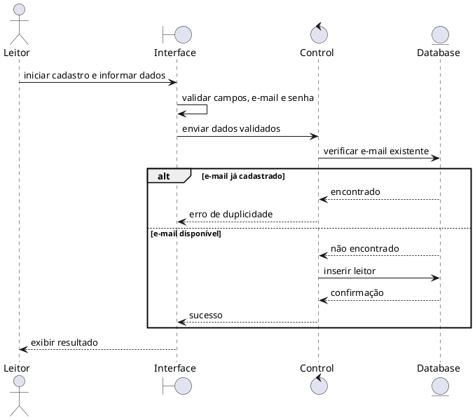
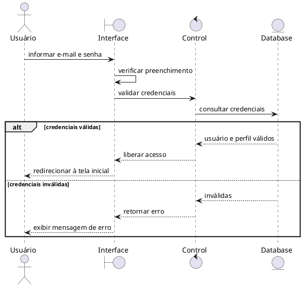
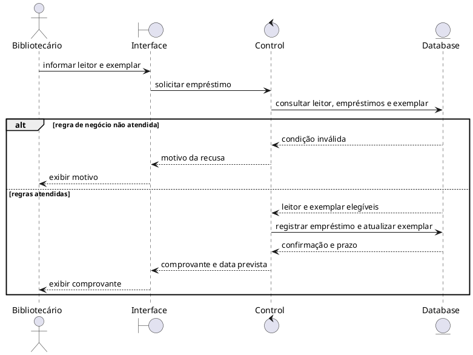
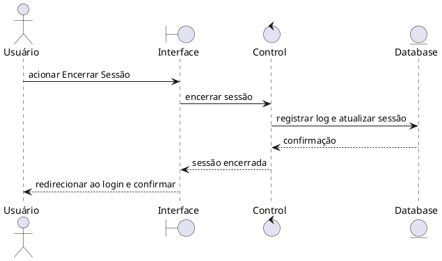
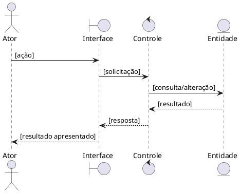

# Diagramas de Sequência

Os fluxos seguem o padrão Boundary (Interface) – Control – Entity (Database). O material recebido descreve as interações abaixo; as fontes PlantUML registram esses passos para facilitar a renderização dos diagramas.

## Sequência: cadastrar leitor (Figura 2)

1. Leitor envia dados à interface.
2. Interface valida campos, formato do e-mail e tamanho mínimo da senha e encaminha ao controle.
3. Controle consulta o banco para verificar e-mail existente.
4. Se duplicado, retorna erro; caso contrário, insere o leitor e retorna sucesso.
5. Interface exibe a resposta ao leitor.

## Sequência: login (Figura 3)

1. Usuário informa e-mail e senha.
2. Interface verifica preenchimento e aciona o controle.
3. Controle consulta o banco para validar as credenciais.
4. Credenciais válidas liberam acesso e direcionam à tela inicial; inválidas geram erro.

## Sequência: realizar empréstimo (Figura 4)

1. Bibliotecário informa leitor e exemplar na interface.
2. Interface envia solicitação ao controle.
3. Controle consulta situação do leitor, empréstimos ativos, disponibilidade e tipo do exemplar.
4. Se regra não for atendida, retorna motivo; caso contrário, registra empréstimo e atualiza exemplar para “emprestado”.
5. Interface exibe comprovante e data de devolução.

## Sequência: logout (Figura 5)

1. Usuário aciona “Encerrar Sessão” na interface.
2. Controle registra log e atualiza o banco.
3. Interface redireciona à tela de login e informa o encerramento.

## Template

