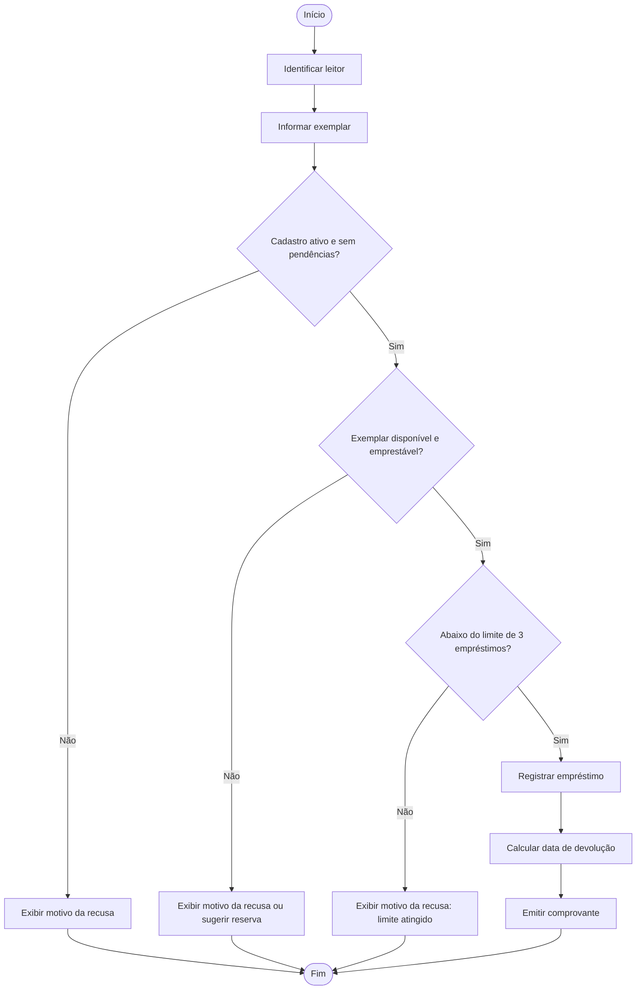
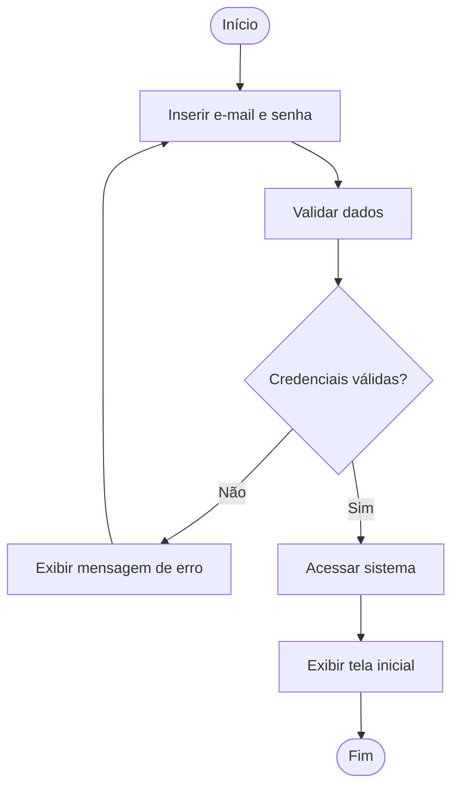

# 3.3. Diagramas de Atividades

## Atividade: realizar empréstimo (Figura 6)

Fluxo: início → identificar leitor → informar exemplar → verificar cadastro ativo e ausência de pendências (RN05). Se inválido, exibir o motivo da recusa e encerrar; se válido, verificar disponibilidade e se o exemplar pode ser emprestado (RN07). Se indisponível ou de consulta local, exibir o motivo ou sugerir reserva e encerrar; se disponível, verificar o limite de três empréstimos (RN01). Se o limite foi atingido, recusar e encerrar; caso contrário, registrar o empréstimo, calcular a data de devolução (RN02), emitir o comprovante e finalizar.

*Figura 6 – Diagrama de Atividades: Realizar Empréstimo.*

## Atividade: login (Figura 7)

Fluxo: início → inserir e-mail e senha → validar dados → credenciais válidas? Se não, exibir mensagem de erro e retornar à inserção; se sim, acessar o sistema → exibir a tela inicial → fim.

*Figura 7 – Diagrama de Atividades: Login.*
