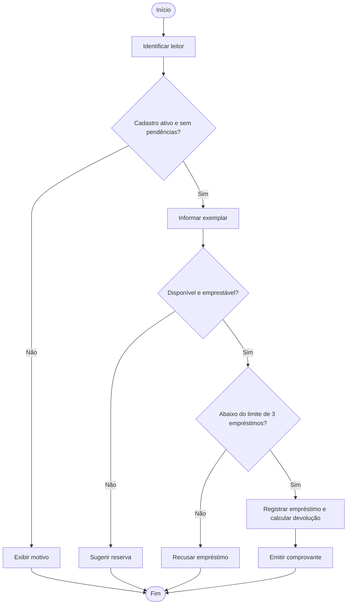
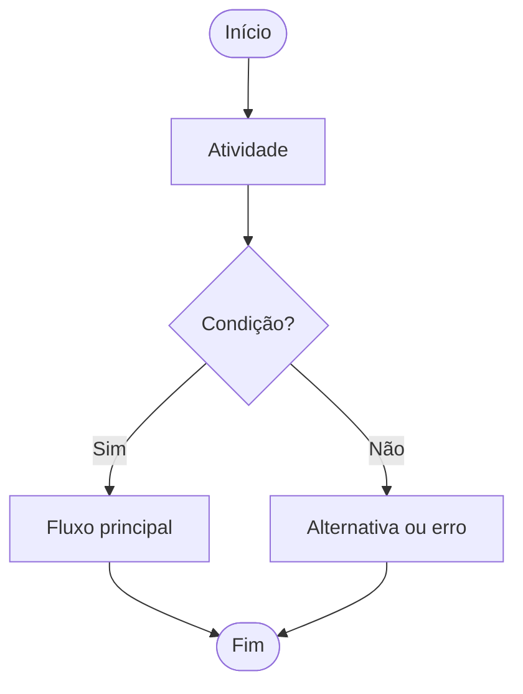

# Diagramas de Atividades

## Atividade: realizar empréstimo (Figura 6)

Fluxo especificado no documento fornecido: início → identificar leitor → verificar cadastro ativo e ausência de pendências. Se inválido, exibir motivo e encerrar; se válido, informar exemplar → verificar disponibilidade e se pode ser emprestado. Se indisponível ou de consulta local, sugerir reserva e encerrar; se disponível, verificar limite de três empréstimos. Se o limite foi atingido, recusar e encerrar; caso contrário, registrar empréstimo, calcular devolução, emitir comprovante e finalizar.

## Atividade: login (Figura 7)

Início → inserir e-mail e senha → validar dados → credenciais válidas? Se não, exibir erro e retornar à inserção; se sim, acessar sistema → exibir tela inicial → fim.

## Template de atividade

Ao adicionar um fluxo, identifique claramente início/fim, decisões, alternativas, erros e requisitos/regras relacionados. Os diagramas de atividade acima são representações textuais dos fluxos descritos, não imagens das figuras originais.
